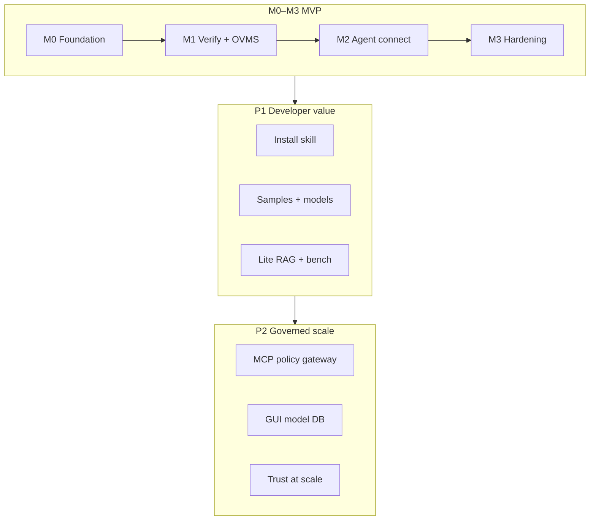

# Quick Agent Track — Implementation Roadmap

Intel AI PC Dev Kit 4.x · Skills-first agentic path  
**Sources:** executive deck (M0–M3, P0/P1/P2), `AgentSkills-v1.docx` MVP ordering  
**Companion:** [`MVP-CHECKLIST.md`](MVP-CHECKLIST.md) (acceptance tests and exit criteria)

---

## 1. Roadmap principles

1. **Prove the loop before expanding the platform** — install/verify → OVMS → agent → report.  
2. **Skills-first, MCP-later** — reuse MCP *patterns* (CLI, JSON, gates, telemetry); defer MCP *infrastructure*.  
3. **Evidence-gated phases** — next phase starts only when reproducible reports exist on reference hardware.  
4. **One scoped integration surface** — `intel/aipc-devkit-install` scripts and OVMS launchers, not parallel installers.  
5. **Cross-agent by design** — one skill card schema; Hermes and OpenClaw adapters are thin.

---

## 2. Phase overview

| Phase | Name | Duration (indicative) | Goal |
|-------|------|------------------------|------|
| **M0** | Foundation | 1–2 weeks | Schemas, repo, telemetry, reference HW lab |
| **M1** | Verify + OVMS | 2–3 weeks | Read-only + inference path proven |
| **M2** | Agent connect | 2 weeks | Hermes + OpenClaw profiles + smoke report |
| **M3** | MVP hardening | 1–2 weeks | E2E scenarios, docs, security prep |
| **P1** | Developer value | 4–6 weeks | Samples, models, lite RAG, benchmarks |
| **P2** | Governed scale | 6+ weeks | MCP gateway, GUI/DB convergence, optimization |

Indicative **MVP (M0–M3): 6–9 weeks** for a small team; adjust for headcount and HW access.



---

## 3. M0 — Foundation

**Objective:** Everything needed to implement and measure skills consistently.

### Deliverables

| ID | Deliverable | Details |
|----|-------------|---------|
| M0.1 | Decision log | D1–D8 from checklist; default model + OVMS contract frozen |
| M0.2 | `skill-card.schema.json` | Owner, version, risk, inputs/outputs, preflight, actions, observability |
| M0.3 | `skill-result.schema.json` + `validation-report.schema.json` | CLI JSON + human MD companion |
| M0.4 | Repo scaffold | Per `MVP-CHECKLIST.md` §2 |
| M0.5 | Telemetry SQLite | `init-db.sql`, `emit-event` helper, query examples |
| M0.6 | Reference hardware matrix | 1–2 SKUs, drivers, Dev Kit version, expected model/target |
| M0.7 | Wrapper conventions | Exit codes, stdout JSON, stderr human, approval flags |

### Exit gate

- [ ] Empty/stub skills validate against schema  
- [ ] Telemetry records a dummy run end-to-end  
- [ ] Team agrees on canonical skill IDs (deck mapping)

---

## 4. M1 — Verify + OVMS

**Objective:** Local inference endpoint with evidence, without requiring agent hosts.

### Work packages

| ID | Package | Primary scripts / APIs |
|----|---------|-------------------------|
| M1.1 | `intel-devkit-verify` | `Setup_1.ps1` state, logs, `applications.json`, OpenVINO import |
| M1.2 | `intel-ovms-agentic-setup` | `ovms_agentic_setup.ps1`, `/v3/models`, chat + tool tests |
| M1.3 | `intel-endpoint-smoke-test-report` | Composes verify + OVMS checks; golden JSON reports |
| M1.4 | Install skill spike (optional parallel) | `intel-devkit-install` design only if top-up not enough for lab |

### Sequencing

```text
Week 1: M1.1 verify (read-only) + golden reports
Week 2: M1.2 OVMS wrapper + built-in -Test parity
Week 3: M1.3 smoke report + reference HW runs
```

### Exit gate

- [ ] Checklist §4.1, §4.3, §4.5 pass on reference HW  
- [ ] Scenario A steps A1, A2, A5 pass without Hermes/OpenClaw  
- [ ] Failure modes documented per skill card

---

## 5. M2 — Agent connect

**Objective:** Hermes and OpenClaw use OVMS through staged, approved configuration.

### Work packages

| ID | Package | Notes |
|----|---------|-------|
| M2.1 | `intel-agent-provider-config` (Hermes) | `http://localhost:8000/v3`, locked model; diff-only default |
| M2.2 | Same skill (OpenClaw) | Sandbox/test defaults; security doc cross-links |
| M2.3 | Hermes bundle | `adapters/hermes/bundles/intel-devkit-quick-agent.yaml` |
| M2.4 | OpenClaw skill pack | AgentSkills layout + `metadata.openclaw.requires` |
| M2.5 | `openvino-coding-assistant-lite` | Version-bound lite assistant skill |

### Exit gate

- [ ] Checklist §4.4, §4.6 complete  
- [ ] Scenario A full pass (Hermes)  
- [ ] Scenario B pass (OpenClaw) or documented waiver  
- [ ] No silent config writes in any P0 script

---

## 6. M3 — MVP hardening

**Objective:** Stakeholder-ready MVP: reproducible, documented, security-aware.

### Work packages

| ID | Package | Notes |
|----|---------|-------|
| M3.1 | `intel-devkit-install` productionize | Async/progress if install exceeds agent timeouts |
| M3.2 | Integration test suite | `tests/integration/` + golden logs |
| M3.3 | `docs/security-model.md` | OpenClaw posture, approvals, supply chain |
| M3.4 | `docs/troubleshooting.md` | MOTW, logs, exit codes from installer README |
| M3.5 | MVP demo script | Operator + agent-driven (Scenario C) |
| M3.6 | Stakeholder summary | Time-to-first-success on reference HW |

### Exit gate

- [ ] All MVP exit criteria in `MVP-CHECKLIST.md` §8  
- [ ] Tag `v0.1.0-mvp`  
- [ ] Security review scheduled (pre-external publish)

---

## 7. P1 — Developer value (post-MVP)

**Objective:** Skills that reduce daily Dev Kit friction beyond the first agent chat.

| Priority | Skill | Depends on |
|----------|-------|------------|
| P1.1 | `intel-model-management` | MVP telemetry + model DB discovery |
| P1.2 | `intel-sample-setup` | Verify skill, uv/venv patterns |
| P1.3 | `openvino-docs-rag-builder` | Version-matched doc manifest |
| P1.4 | `intel-benchmark-and-telemetry` | OVMS metrics, agentic bench guidance |
| P1.5 | `skill-card-generator` | Stable schemas from M0 |
| P1.6 | `intel-devkit-troubleshooter` | Structured logs from M1 |

### Suggested order

```text
P1.2 sample-setup → P1.1 model-management → P1.6 troubleshooter
→ P1.3 RAG builder → P1.4 benchmark → P1.5 generator
```

### Exit gate

- [ ] Each P1 skill meets minimum acceptance metadata (checklist §3)  
- [ ] At least one P1 skill validated on second HW profile (CPU-only or NPU)

---

## 8. P2 — Governed scale

**Objective:** Trust differentiators and platform depth without breaking the MVP loop.

| Track | Deliverable | Notes |
|-------|-------------|-------|
| P2.1 | Policy-aware MCP gateway | Single scoped server or strict allowlists; not seven ports by default |
| P2.2 | `intel-mcp-devkit-bridge` | After gateway design; include/exclude tool filters |
| P2.3 | GUI / shared model DB | Align with AI Playground + CLI install DB schema |
| P2.4 | `openvino-quantize-optimize` | NNCF/Optimum; license + artifact provenance |
| P2.5 | Scan/sign pipeline | Skill repo CI, hardware-fit cards at scale |
| P2.6 | Linux parity | `scripts/linux/` adapters match Windows P0/P1 |

### Exit gate

- [ ] MCP design reviewed against context-poisoning / tool-surface risks  
- [ ] MCP optional path does not regress skills-only MVP  
- [ ] External publish criteria met (sign-off + scan reports)

---

## 9. Cross-cutting workstreams (all phases)

| Workstream | M0–M3 | P1 | P2 |
|------------|-------|----|----|
| **Validation lab** | Reference HW + golden reports | Second SKU | Fleet matrix |
| **Schema evolution** | v1 frozen for MVP | backward-compatible v1.1 | major only with migration |
| **Installer sync** | Track `aipc-devkit-install` releases | Post-install hooks | Silent/top-up installer UX |
| **Agent ecosystem** | Hermes + OpenClaw | Continue.dev eval | SuperClaw / hubs |
| **Docs** | implementation-notes | AI Recipes linkage (`recipe1` style) | Public skill catalog |

---

## 10. Risk register → roadmap mitigations

| Risk | Phase | Mitigation |
|------|-------|------------|
| Long install vs agent timeout | M3 | Job spawn, progress events, resume/cancel in install skill |
| Stale OpenVINO APIs from local LLM | M2–P1 | Version bind + lite RAG + compile/test in coding assistant |
| OpenClaw security | M2–M3 | Test-only defaults, security-model.md, no MSI bundling |
| MCP complexity | P2 only | Skills path remains primary; MCP behind gateway |
| GUI/CLI model DB split | P2 | Schema working group before P2.3 coding |
| Competitive time-to-success | M1–M3 | Optimize top-up path; measure Scenario A wall-clock |

---

## 11. Milestones & stakeholder checkpoints

| Milestone | When | Demo |
|-----------|------|------|
| **MS1** | End M0 | Schema + telemetry + empty repo |
| **MS2** | End M1 | OVMS up + smoke JSON report on reference HW |
| **MS3** | End M2 | Hermes chat on local OVMS via skill path |
| **MS4** | End M3 | Full MVP checklist sign-off + tag `v0.1.0-mvp` |
| **MS5** | Mid P1 | Sample setup + model list skills |
| **MS6** | End P2 | MCP gateway POC + publish readiness review |

**Recommended steering agenda (post-M3):** review P1 priority using MVP telemetry (which skills fail most on real machines).

---

## 12. Team roles (suggested)

| Role | M0–M3 focus |
|------|-------------|
| **Skill platform** | Schemas, CLI wrappers, SQLite telemetry |
| **Dev Kit integration** | Installer/OVMS script parity, logs, HW lab |
| **Agent adapters** | Hermes bundles, OpenClaw SKILL.md, provider configs |
| **Validation** | Golden reports, reference HW, checklist sign-off |
| **Security** | Gates G1–G5, OpenClaw posture, publish review |

---

## 13. Immediate next actions (from executive deck)

1. Lock MVP scope and acceptance tests → use `MVP-CHECKLIST.md` §0 and §8.  
2. Freeze default model + OVMS endpoint contract → decision log M0.1.  
3. Create Hermes/OpenClaw profiles and smoke tests → M2 work packages.  
4. Define skill-card schema + validation report → M0.2–M0.3.  
5. Schedule security posture review before external publishing → M3.5 / G5.

---

## 14. Success metrics

| Metric | MVP target | Measured how |
|--------|------------|--------------|
| Time to first local agent chat | Improve vs ~30 min baseline; document top-up path | Scenario A wall-clock |
| Reproducibility | Same HW + version → comparable JSON reports | Diff golden reports |
| Verification honesty | Zero false positives on verify/smoke | Negative tests on broken OVMS |
| Agent safety | 100% mutating ops require approval | Telemetry audit |
| Cross-agent | Hermes + OpenClaw both pass smoke | Scenarios A & B |

---

*Document version: 1.0 · Align with checklist updates when skill IDs or schemas change.*
